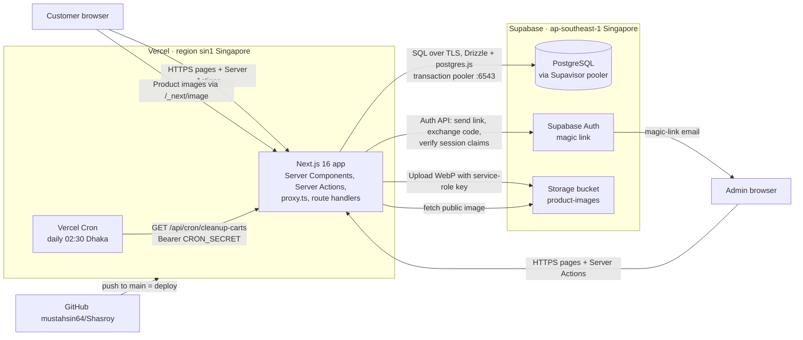
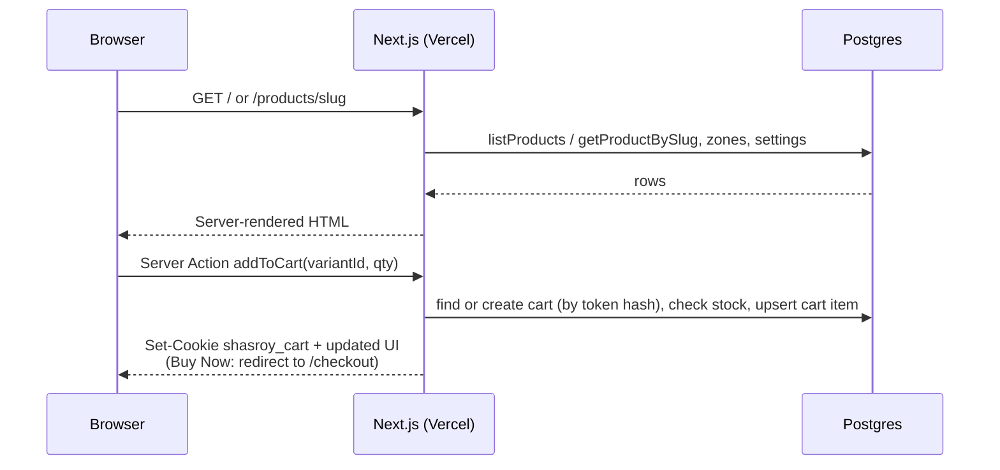
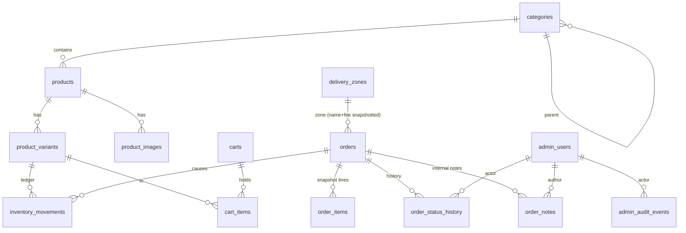
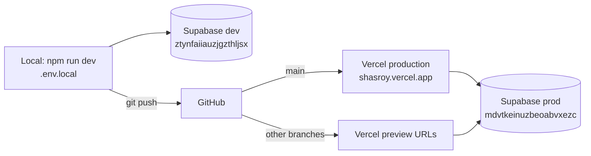

# Shasroy — architecture and system design

Updated: 22 October 2026. Describes the code on `main` / `shasroy-development` (commit `c4e366f`) and the live deployment at https://shasroy.vercel.app.

## 1. Overview

Shasroy (সাশ্রয়) is a Bangla e-commerce shop based in Rajshahi. Customers browse, add to a bag and order as guests with cash on delivery (COD). Staff manage products, stock, orders and delivery from an admin panel.

The system is a **modular monolith**: one Next.js 16 application contains the storefront, the admin panel and all server logic. There is no separate backend service and no public REST API. The browser never talks to the database directly.



## 2. Technology stack

| Layer | Technology |
| --- | --- |
| Framework | Next.js 16 App Router (`proxy.ts` replaces `middleware`), React 19, TypeScript |
| UI | Server Components by default; small client components for interaction. Tailwind 4 + hand-written CSS (`storefront.css`, `admin.css`, `print.css`). Font: Noto Serif Bengali (self-hosted). Icons: lucide-react |
| Server logic | Server Actions (forms) and two route handlers (`/auth/callback`, `/api/cron/cleanup-carts`) |
| Validation | Zod 4 (`src/lib/validation.ts`, per-feature schemas) |
| Database access | Drizzle ORM 0.45 on `postgres` (postgres.js), `prepare: false` for the transaction pooler |
| Database | Supabase PostgreSQL |
| Auth | Supabase Auth (magic link) through `@supabase/ssr`, admins only |
| Files | Supabase Storage, images converted to WebP with `sharp` |
| Hosting | Vercel (serverless functions, CDN, Cron) |
| Tests | Node test runner via `tsx`: unit tests and database integration tests |

## 3. Project structure

```text
B-shasroy/
├─ src/
│  ├─ app/                         Next.js routes
│  │  ├─ layout.tsx                Root layout: font, metadata, Open Graph, JSON-LD
│  │  ├─ (shop)/                   Storefront (route group with its own header/footer)
│  │  │  ├─ page.tsx               Home: hero carousel, new arrivals, categories, product grid, FAQ
│  │  │  ├─ products/[slug]/       Product page: gallery, variants, delivery zones, Buy Now / Add
│  │  │  ├─ cart/                  Bag page + actions (add, change quantity, remove)
│  │  │  ├─ checkout/              Checkout form + placeOrder action
│  │  │  ├─ order/[id]/            Order confirmation
│  │  │  └─ error.tsx, not-found.tsx
│  │  ├─ admin/
│  │  │  ├─ login/                 Magic-link request form (public)
│  │  │  └─ (panel)/               Protected admin area
│  │  │     ├─ page.tsx            Dashboard
│  │  │     ├─ orders/             List, search, detail, status, notes, print slip
│  │  │     ├─ products/           Products, variants, stock, images, stock history
│  │  │     ├─ categories/         Category management
│  │  │     ├─ delivery/           Delivery zones and fees
│  │  │     ├─ settings/           Gift wrap fee and on/off
│  │  │     └─ users/              Admin users (owner only)
│  │  ├─ auth/callback/route.ts    Magic-link landing: code → session cookie
│  │  ├─ api/cron/cleanup-carts/   Deletes carts idle for 30 days
│  │  ├─ sitemap.ts, robots.ts     SEO
│  │  └─ *.css                     Global, storefront, admin and print styles
│  ├─ components/                  Shared UI (header, footer, hero, product card, forms, JSON-LD)
│  ├─ db/
│  │  ├─ schema.ts                 All tables, enums, checks, indexes, RLS flags
│  │  └─ index.ts                  Server-only Drizzle client (pool max 5)
│  ├─ lib/                         Server-side services
│  │  ├─ catalog.ts, cart.ts, checkout.ts        Storefront services
│  │  ├─ admin/*.ts                Admin services (orders, notes, products, categories,
│  │  │                            delivery, inventory, users, settings, audit)
│  │  ├─ admin-auth.ts, roles.ts   Authentication and role checks
│  │  ├─ supabase/server.ts        Supabase client bound to request cookies
│  │  ├─ storage.ts                Image upload/URL helpers
│  │  ├─ shop-settings.ts, shop-contact.ts       Shop settings and public contact details
│  │  ├─ money.ts, format.ts, validation.ts      Taka/paisa, Bangla formatting, Zod rules
│  │  └─ env.ts, log.ts, rate-limit.ts, site.ts, cart-cleanup.ts, db-errors.ts
│  └─ proxy.ts                     Refreshes admin session; redirects signed-out /admin visits
├─ drizzle/                        SQL migrations 0000–0003 + snapshots
├─ scripts/seed.ts                 Repeatable seed: categories, zones, sample products, owner
├─ tests/                          unit.test.mts, db.test.mts
├─ public/                         Logo, hero images, static assets
├─ vercel.json                     Region sin1, cron schedule
├─ drizzle.config.ts, next.config.ts, tsconfig.json, eslint.config.mjs
└─ HANDOVER.md, ARCHITECTURE.md, AGENTS.md
```

**Layering rule:** pages and Server Actions are thin. They validate input, check permissions and call a service in `src/lib/`. Services own the business rules and the database transactions. All services are `server-only`, so they can never be bundled into browser code.

## 4. Frontend

### Storefront (`src/app/(shop)/`)

- Rendered on the server for every request. The header reads the cart cookie to show the bag count, so storefront pages are dynamic and not statically cached. The only cached route is `sitemap.ts` (1 hour).
- Pages are React Server Components that query the database directly through services. The browser receives HTML plus the small client components it needs.
- Client components handle interaction only: hero carousel, new-arrivals belt, product gallery, add-to-cart / quick-add buttons, checkout form (gift wrap toggle, live totals).
- Forms post to **Server Actions** (`useActionState`). There are no fetch calls or JSON APIs in the browser; Next.js sends the form to the server and returns the new UI state.
- Images go through `next/image`, which resizes and serves product photos from the Supabase public bucket via Vercel's image optimizer.
- SEO: server-rendered HTML, sitemap, robots (admin and checkout disallowed), Open Graph, JSON-LD for the organization and products.

### Admin panel (`src/app/admin/`)

- Same rendering model: Server Components + Server Actions.
- `(panel)/layout.tsx` calls `requireAdmin()` and shows only the links the role may use.
- Print slips (`/admin/orders/[id]/print?size=a4|a5`) are HTML pages styled by `print.css`; the browser prints or saves to PDF.

## 5. Backend (server logic inside Next.js)

### Entry points

| Entry point | Used for |
| --- | --- |
| Server Components (pages) | Reading data: catalog, product, cart, order, admin lists |
| Server Actions (`actions.ts`) | Every write: cart changes, placing an order, all admin changes, login link |
| `src/proxy.ts` | Runs on `/admin/*` and `/auth/*`: refreshes the Supabase session cookie and redirects signed-out users to `/admin/login` |
| `GET /auth/callback` | Exchanges the magic-link code for a session cookie |
| `GET/POST /api/cron/cleanup-carts` | Deletes carts not updated for 30 days; requires `Authorization: Bearer CRON_SECRET` |

### Security model

- **Customers** are anonymous. The cart is identified by a random token in an httpOnly cookie (`shasroy_cart`, 30 days); the database stores only its SHA-256 hash.
- **Admins** sign in with a Supabase magic link. Authentication (who you are) comes from Supabase; authorization (what you may do) comes from our own `admin_users` table:
  - `proxy.ts` is only a convenience redirect.
  - Every admin page calls `requireAdmin(minRole)` and every admin action calls `assertAdmin(minRole)`. Both verify the session claims and require an active `admin_users` row.
  - Roles: **staff** = orders; **manager** = + products, categories, delivery, settings, stock history; **owner** = + admin users.
- Prices, stock and totals are always computed on the server; the browser never sends a price.
- All input is validated with Zod; the database repeats the critical rules as CHECK constraints.
- Rate limits (in memory, per server instance): checkout 10 per 5 minutes per IP; login link 5 per 10 minutes per IP.
- Logging: one JSON line per event (`src/lib/log.ts`), no secrets or personal data.

### Key flows

**Browse and add to bag**



**Place an order (COD)** — `placeOrder` in `src/lib/checkout.ts` runs as one database transaction:

```mermaid
sequenceDiagram
  participant B as Browser
  participant N as Next.js
  participant D as Postgres
  B->>N: Server Action checkout(name, phone, address, zone,<br/>expected fee, gift wrap, message)
  N->>N: rate limit, Zod validation
  N->>D: BEGIN
  N->>D: lock cart; read zone (FOR SHARE); read gift settings (FOR SHARE)
  N->>N: refuse if fee changed since the customer saw it
  N->>D: lock variants in id order (FOR UPDATE), re-check stock
  N->>D: insert order + item snapshots (names, prices, zone, fees)
  N->>D: decrement stock, insert inventory movements + status history
  N->>D: delete cart; COMMIT
  N-->>B: clear cart cookie, redirect /order/[id]
```

If anything fails (out of stock, fee changed, gift wrap disabled) the transaction rolls back and nothing is changed.

**Admin sign-in**

```mermaid
sequenceDiagram
  participant A as Admin browser
  participant N as Next.js
  participant D as Postgres
  participant S as Supabase Auth
  A->>N: email on /admin/login
  N->>D: is this an active admin_users row?
  N->>S: signInWithOtp (only if yes; same reply either way)
  S-->>A: email with magic link
  A->>N: GET /auth/callback?code=...
  N->>S: exchangeCodeForSession
  N-->>A: session cookie, redirect /admin
  A->>N: any admin page
  N->>S: verify claims
  N->>D: load admin_users (link identity on first sign-in), check role
```

**Admin changes** (order status, delivery fee, gift wrap fee, admin users): one transaction that locks the row, checks `updated_at` against the value the form was loaded with (optimistic concurrency, so stale forms are refused), writes the change, and writes an `admin_audit_events` row. Cancelling an order restores stock exactly once.

**Image upload:** admin form → Server Action → size/type check (4 MB) → `sharp` converts to WebP → upload to Storage with the service-role key → row in `product_images`.

## 6. Database

PostgreSQL on Supabase, reached only from the server.

- App runtime: `DATABASE_URL` = Supavisor **transaction pooler** (port 6543), postgres.js pool `max: 5` per server instance, no prepared statements.
- Migrations and seed: `DATABASE_URL_DIRECT` = **session pooler** (port 5432), through `drizzle-kit`.
- **RLS is enabled on every table with no policies.** The Supabase Data API (anon/publishable key) therefore sees nothing; only the server's direct connection can read or write.
- Money is stored as integer **paisa** (৳1 = 100 paisa).



| Table | Purpose |
| --- | --- |
| `categories` | Category tree, Bangla names, active flag |
| `products` | Product (draft / active / archived) |
| `product_variants` | SKU, price (paisa), stock, active, one default per product |
| `product_images` | Storage paths and order |
| `delivery_zones` | Name, fee, delivery days, active, sort (Inside Rajshahi ৳30, Outside ৳120) |
| `shop_settings` | Single row: gift wrap on/off and fee |
| `carts`, `cart_items` | Guest bags (token hash), cleaned after 30 days |
| `orders` | Customer, address, zone snapshot, subtotal + delivery + gift wrap − discount = total, payment method/status, order status |
| `order_items` | Name/variant/price snapshot per line |
| `order_status_history` | Every status change with actor and note |
| `order_notes` | Internal admin notes (append-only) |
| `inventory_movements` | Stock ledger: initial, restock, order, cancellation, adjustment |
| `admin_users` | Admin email, linked Supabase user id, role, active |
| `admin_audit_events` | Audit log of settings, zone and admin-user changes |

Data integrity is enforced in the database as well as in code: CHECK constraints (non-negative amounts, total matches its parts, gift fields consistent, note length), unique indexes, foreign keys, and row locks during checkout and admin edits.

**Migrations:** `drizzle/0000_init` → `0001_carts` → `0002_phase7_notes_audit` → `0003_gift_wrap_settings`. Change `src/db/schema.ts`, run `npm run db:generate`, review the SQL, then `npm run db:migrate` (development, then production with `.env.prod`).

## 7. Deployment and environments



| Environment | App | Database / Auth / Storage |
| --- | --- | --- |
| Development | `localhost:3000`, `.env.local` | Supabase dev project (seed data, tests) |
| Production | Vercel `shasroy`, region `sin1`, Hobby plan | Supabase "Shasroy Prod", Singapore, free plan |
| Preview | Vercel preview deploy per pushed branch | Uses the env vars scoped to Preview in Vercel. **Check this before pushing branches:** if Preview shares production variables, preview builds read and write the live database |

- **Deploy:** every push to `main` builds and deploys automatically. Database migrations are not automatic; run them before pushing code that needs them.
- **Vercel env vars:** `NEXT_PUBLIC_SUPABASE_URL`, `NEXT_PUBLIC_SUPABASE_PUBLISHABLE_KEY`, `SUPABASE_SERVICE_ROLE_KEY`, `DATABASE_URL`, `NEXT_PUBLIC_SITE_URL`, `CRON_SECRET`.
- **Cron:** `vercel.json` runs cart cleanup daily at 20:30 UTC (02:30 Dhaka).
- **Region:** app (Singapore) and database (Singapore) are co-located, so each query is a short hop; users in Bangladesh are roughly 40–60 ms from Singapore.

## 8. Current scope

**In scope (built):**

- Bangla storefront: categories, search, sort, product variants, stock labels, hero carousel, new arrivals, FAQ, contact links
- Guest bag, Buy Now, quick add
- COD checkout with two delivery zones, optional gift wrap (per-order fee, message, price-free slip)
- Admin: orders (search, status, notes, print A4/A5), products, variants, stock and history, images, categories, delivery zones, settings, admin users with 3 roles, audit log
- SEO, error pages, rate limits, cart cleanup, structured logs

**Not built yet:** online payment (SSLCOMMERZ; the enum is ready), courier API, SMS/email to customers, customer accounts and order tracking, reviews, coupons/discounts (column exists, always 0), product pagination beyond 60, analytics, automated backups, custom domain, error alerting.

## 9. Scalability and user capacity

### What limits the system today

| Area | Current state | Effect |
| --- | --- | --- |
| Page rendering | Every storefront page renders on demand and queries the database (no page or data cache) | Database load grows with every page view |
| DB connections | Each Vercel function instance keeps up to 5 connections through the transaction pooler | Pooler absorbs bursts; the free tier's pooler and the small compute are the first ceiling |
| Database size | Supabase free: 500 MB database, 1 GB storage | Fine for thousands of products and tens of thousands of orders |
| Supabase free pausing | Free projects pause after about a week with no activity | Must stay active or move to Pro before real launch |
| Backups | Free plan has no downloadable daily backups or point-in-time recovery | Real orders need Pro or a manual `pg_dump` routine |
| Hosting | Vercel Hobby is for personal, non-commercial use | A selling shop should move to Vercel Pro |
| Auth email | Supabase built-in sender is heavily rate-limited | Only affects admin logins; add SMTP |
| Rate limits | In memory, per function instance | Stops casual abuse only, not a distributed attack |
| Search | `ILIKE` on name/description, no full-text index; listing capped at 60 products | Fine for a few hundred products; needs pagination and an index beyond that |
| Checkout locking | Row locks per variant | Correct under concurrency; only very hot single items (flash sale) would queue |

### Estimated capacity (current code, current free plans)

These are estimates from the design, not load-test results.

- **Catalog:** comfortable up to a few hundred active products (60 shown per listing).
- **Traffic:** roughly a few thousand visitors per day and around 10–30 concurrent shoppers browsing without noticeable slowdown.
- **Orders:** hundreds per day are well within limits; checkout is a single short transaction.
- **Admins:** a handful of staff at once; edits are safe thanks to locks and stale-form checks.

That fits a small to medium Rajshahi shop with nationwide delivery. The practical limits will be the free-plan quotas (bandwidth, image optimization, database pausing) before the code itself.

### Path to scale

1. **Before real sales:** Vercel Pro, Supabase Pro (no pausing, daily backups), custom domain, SMTP. Low cost, no code changes.
2. **More traffic (tens of thousands of visits a day):** cache catalog reads (`use cache` with tags, invalidated by admin edits) and keep the bag count client-side so storefront pages can be served from the CDN; move rate limiting to a shared store (for example Upstash Redis); add Postgres full-text or trigram search and pagination.
3. **Larger scale:** bigger Supabase compute and read replicas, image CDN tuning, background jobs for notifications (SMS/email, courier booking) through a queue, monitoring and alerting (Sentry or similar).

The modular-monolith structure (thin routes, services in `src/lib/`) means each of these steps is local: caching and new integrations sit around the existing services without splitting the app into separate backends.
